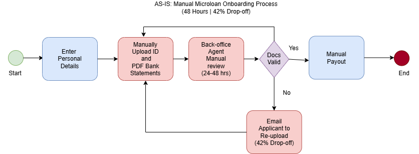
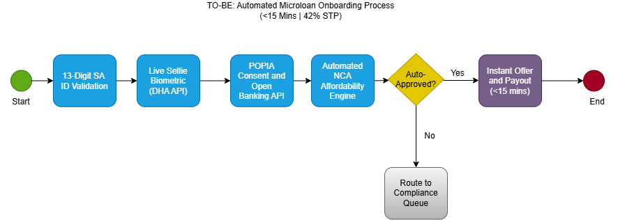

# Business Process Models (As-Is vs. To-Be)
**Project:** Digital Microloan Onboarding Optimization  
**Modeling Standard:** BPMN 2.0 (Created via Draw.io)  

---

## 1. Current State ("As-Is" Manual Process)
In the existing workflow, applicants must manually scan and upload FICA documents and PDF bank statements. Back-office credit agents manually verify documents, creating a **24-to-48-hour bottleneck** and driving a **42% funnel abandonment rate**.

### Key Bottlenecks Identified
* **Manual Document Collection:** High friction for mobile users uploading multi-page PDF statements.
* **Human Review Queue:** Back-office verification delays decisioning by up to 2 business days.
* **High Rework Rate:** Blurry ID scans require manual email follow-ups, causing applicants to abandon the process.

---

## 2. Future State ("To-Be" Automated Process)
The redesigned workflow replaces manual document uploads with **real-time API integrations** (Department of Home Affairs biometric verification and Open Banking statement retrieval), reducing end-to-end decisioning to **under 15 minutes**.

### Key Improvements
* **Instant KYC/FICA:** Live selfie biometric matching eliminates manual ID uploads.
* **Automated NCA Affordability:** Open Banking APIs pull 90 days of verified transactions with explicit POPIA consent.
* **Straight-Through Processing (STP):** Low-risk applications receive instant automated offers without manual agent intervention.
