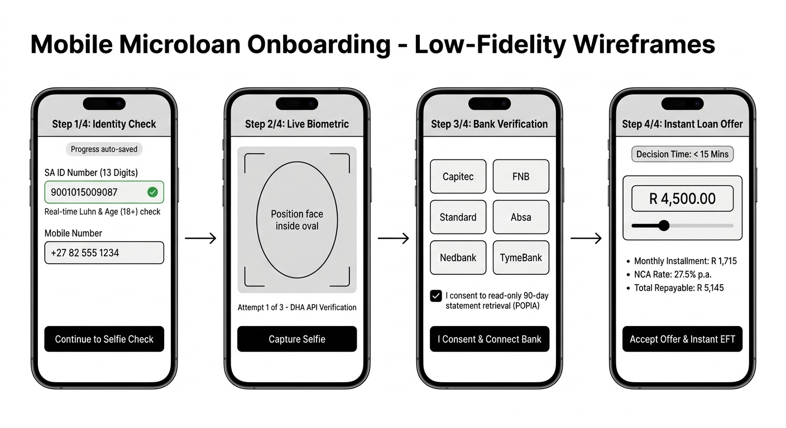

# Low-Fidelity Mobile Wireframes: Automated Microloan Onboarding
**Project:** Digital Microloan Onboarding Optimization  
**Traceability:** Aligned with `FR-01` to `FR-05` and `US-01` to `US-05`  

---

---

## 1. UX Design Principles
* **Zero Manual Uploads:** Replaces PDF statements and certified ID scans with real-time DHA and Open Banking API screens.
* **Resilient Mobile UX (`US-05`):** Displays an auto-save status indicator so users can safely resume within 7 days if mobile data drops.
* **Regulatory Transparency (`US-03`, `US-04`):** Embeds explicit POPIA consent and NCA cost-of-credit breakdowns directly into the user journey.

---

## 2. Screen-by-Screen Functional Specifications

### Step 1: 13-Digit SA ID Validation (`FR-01` | `US-01`)
* **Purpose:** Captures applicant identification and mobile contact details with instant inline validation.
* **System Behavior:** Validates the 13-digit SA ID number in real time using the Luhn checksum and verifies that applicant age is ≥ 18 before enabling **Continue to Selfie Check**.

### Step 2: Live Selfie Biometric Verification (`FR-02` | `US-02`)
* **Purpose:** Replaces manual ID document scans with automated facial biometric KYC.
* **System Behavior:** Captures a live selfie and verifies against Department of Home Affairs (DHA) records within 30 seconds. After **3 consecutive failed attempts**, the application automatically routes to the **Compliance Queue** (`02-Process-Models`).

### Step 3: POPIA Consent & Open Banking API (`FR-03` | `US-03`)
* **Purpose:** Eliminates manual 90-day PDF bank statement uploads while maintaining strict privacy compliance.
* **System Behavior:** Requires explicit digital POPIA consent before securely retrieving 90 days of read-only transactional history via Open Banking API. Declining consent pauses the application cleanly without storing financial data.

### Step 4: Instant Loan Offer & Exception Handling (`FR-04` | `US-04`)
* **Straight-Through Processing (Auto-Approved):** Presents a personalized NCA-compliant loan offer, interest rate, and repayment breakdown within 15 seconds for instant EFT payout.
* **Exception Path (Compliance Queue):** If automated affordability or biometric thresholds require review, the applicant receives a reference number and real-time status updates without needing to re-upload documents.
